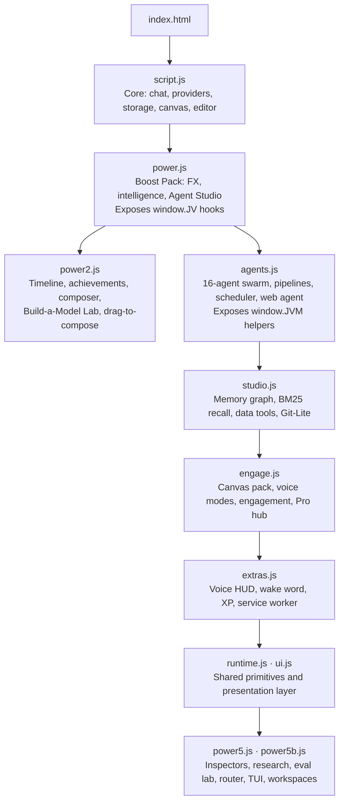

<div align="center">

# ◉ JARVIK AI

### The browser-native AI workspace

**Chat. Code. Documents. Data. Voice. Agents. All in one place.**

[](#)
[](#)
[](#)
[](#)
[](#)
[](#)

[Features](#-features) ·
[Quick Start](#-quick-start) ·
[Providers](#-providers-and-models) ·
[Architecture](#%EF%B8%8F-architecture) ·
[Privacy](#-privacy-and-security) ·
[Limitations](#%EF%B8%8F-honest-limitations)

</div>

---

## ✨ What is JARVIK AI?

JARVIK AI is a **browser-native AI workspace** that brings together streaming chat, a live coding canvas, a browser-based editor, document and data tools, voice control, multi-agent workflows, and peer-to-peer collaboration.

It is designed to run entirely on your device:

- No backend required
- No build pipeline required
- No account required
- Bring your own API key
- Your data stays in your browser

JARVIK connects directly to the AI provider you choose. Prompts, attachments, and memory context are sent from your browser to that provider—not through a server operated by JARVIK.

> **Design principle:** Local-first, provider-agnostic, and transparent about what each feature can and cannot do.

---

## 🚀 Highlights

| Capability | What you get |
|---|---|
| **Model-agnostic chat** | Connect OpenRouter, OpenAI, Anthropic, Gemini, Groq, NVIDIA, Together, Mistral, DeepSeek, Ollama, or a custom endpoint |
| **Co-Work Canvas** | Generate apps and pages beside the chat, with live preview, editable code, and console output |
| **Coding workspace** | File tree, tabs, terminal, JavaScript runner, Git-Lite snapshots, and ZIP export |
| **Agent Studio** | 16 role-based agents, agent swarms, pipelines, task queues, and scheduled runs |
| **Documents & research** | Attachments, project knowledge, memory graph, smart recall, web reader, and YouTube notes |
| **Data tools** | CSV insights, in-browser SQL, spreadsheet import, PDF extraction, flashcards, and code review |
| **Voice** | Voice typing, wake word, meeting mode, podcast mode, and screen recording |
| **Team Rooms** | Peer-to-peer rooms with presence, shared context, live cursors, and room replay |
| **Installable PWA** | Offline-cached app shell and installable web app experience |

---

## 📚 Table of Contents

- [Features](#-features)
- [Quick Start](#-quick-start)
- [Providers and Models](#-providers-and-models)
- [Keyboard Shortcuts](#%EF%B8%8F-keyboard-shortcuts)
- [Architecture](#%EF%B8%8F-architecture)
- [Project Structure](#-project-structure)
- [Privacy and Security](#-privacy-and-security)
- [Honest Limitations](#%EF%B8%8F-honest-limitations)
- [Roadmap](#%EF%B8%8F-roadmap)
- [Contributing](#-contributing)
- [License](#-license)

---

## 🚀 Features

### 💬 Chat and Response Controls

| Feature | Description |
|---|---|
| Streaming chat | See responses as they arrive and interrupt generation with Stop |
| Multiple conversations | Create, rename, search, switch between, and delete chats |
| Retry and branches | Generate alternative responses and move between versions |
| Edit and resend | Revise a previous message and submit it again |
| Model comparison | Send one prompt to two models and compare answers with a text diff |
| Rich responses | Markdown, syntax highlighting, tables, math, and Mermaid diagrams |
| Follow-up actions | Prompt suggestions, rewriting, audience changes, and response metrics |
| Thread search | Search long conversations and jump between messages with a timeline scrubber |
| Message controls | Pin, copy, read aloud, and delete individual messages |
| Prompt Library | Save reusable prompts, including templates with `{{blanks}}` |
| Scratch Pad | Keep quick working notes beside the conversation |

### 🔌 Providers, Models, and Personality

- Configure provider presets with API keys, base URLs, and model IDs
- Request available models where an endpoint supports it
- Control temperature, maximum output tokens, top-p, and system instructions
- Use personas such as Architect, Researcher, Tutor, and Startup Mentor
- Enable Code Mode to encourage complete implementations
- Try personality modes: Roast, Debate Me, Devil’s Advocate, and Gen-Z
- Use Boost to adjust response detail, tone, Hype Mode, and model routing
- Experiment with Build-a-Model Lab, an offline rule-based assistant simulator

### 🎨 Co-Work Canvas and Coding Workspace

| Feature | Description |
|---|---|
| Co-Work Canvas | Open generated artifacts beside the chat with preview, code, and console |
| Artifact explorer | Organize, rename, and delete generated files |
| Live preview | Render HTML, CSS, and JavaScript while capturing console output |
| Responsive previews | Test layouts at phone, tablet, and desktop widths |
| Version comparison | Compare previous and current code line by line |
| Canvas actions | Copy, download, open in a new tab, enter fullscreen, or return code to chat |
| In-app editor | Use a file tree, folders, tabs, language modes, and terminal panel |
| Starter projects | Scaffold small browser-based projects with one click |
| JARVIK Shell | Run built-in commands, file operations, and JavaScript |
| JavaScript runner | Execute supported JavaScript in a worker with timeout handling |
| Git-Lite | Create named local snapshots, inspect diffs, and restore earlier versions |
| ZIP export | Download the workspace as an archive |
| Element picker | Select an element in the preview and ask the AI to modify it |
| Console-error fix | Send an error and relevant code to the model, then apply and rerun the result |

Included Canvas templates:

`Landing Page` · `Dashboard` · `Pricing Page` · `Résumé` · `Kanban Board` · `Pomodoro Timer`

### 🧠 Documents, Memory, and Research

- Attach text, code, images, and supported documents
- Store reusable Project Knowledge as model context
- Build a Memory Panel and Memory Graph with tagged facts and preferences
- Use Smart Recall for keyword-based BM25 retrieval across saved sources
- Search across local sources with Global Search
- Estimate prompt and context usage with the Context Meter
- Create Summary Branches to condense long conversations into reusable context
- Browse pages with the in-app browser and ask questions about the current page
- Extract readable content with the URL Reader and Web Agent
- Turn YouTube transcripts into notes
- Capture screenshots or windows and add them to a prompt

### 📊 Data and Learning Tools

| Tool | Description |
|---|---|
| CSV Insights | Parse CSV files, calculate statistics, plot data, and generate an AI narrative |
| SQL Sandbox | Load CSV into in-browser SQLite using `sql.js` and run queries |
| Spreadsheet Import | Convert Excel sheets to text using SheetJS |
| PDF to Data | Extract PDF text and request structured output |
| Doc Editor | Draft, rewrite, summarize, and title documents |
| Flashcards | Generate study cards and track self-assessed recall |
| Regex Lab | Test regular expressions against sample text |
| JSON Tree | Explore JSON code blocks in an expandable view |
| Codebase Q&A | Ask questions about files in your workspace |
| Code Review | Review pasted code or proposed changes with AI assistance |

### 🤖 Agents, Comparisons, and Automation

Agent Studio includes 16 role prompts:

`Planner` · `Architect` · `Researcher` · `Coder` · `Refactorer` · `Tester` · `Security Reviewer` · `Critic` · `Documentation Writer` · `Data Analyst` · `Growth Adviser` · `Copywriter` · `Interviewer` · `Optimizer` · `Translator/Localizer` · `Release Manager`

- Run an **Agent Swarm** where selected roles work toward a shared goal
- Build reusable **Pipelines** from ordered agent roles
- Use the **Command Composer** for chains such as:
  - Research → Notes → Document
  - Reason → Critic → Improve
  - Plan → Build → Test Plan
- Schedule agents while the page remains open
- Use the Task Queue, Morning Briefing, Debate Arena, and Duel Arena
- Queue failed requests in the Offline Outbox and retry after reconnecting

### 🎙️ Voice, Meetings, and Recording

- Use voice typing and the Voice HUD with listening, thinking, and speaking states
- Activate hands-free mode with the “Hey JARVIK” wake word
- Configure Auto Voice, voice selection, and speech rate
- Turn speech into meeting minutes, decisions, and action items with Meeting Mode
- Read conversations aloud in alternating voices with Podcast Mode
- Record your browser screen with Demo Recorder and download the result

### 👥 Collaboration

- Create peer-to-peer Team Rooms using PeerJS
- Share invitations, presence, workspace context, chat events, and live cursors
- Use personas and replay room activity
- Co-edit across browser tabs using `BroadcastChannel`

### ✍️ Content and Planning

- Generate landing pages with Landing Forge
- Create content with Content Forge and audience rewrite chips
- Convert chat responses into HTML presentations with Chat → Slides
- Plan work with Sprint Roadmap
- Use Profession Packs for founders, students, designers, and product managers
- Generate images through an external image service

### 🛠️ Power Pack 5

| Tool | Purpose |
|---|---|
| Prompt Inspector | Inspect the exact prompt blocks sent to a model |
| Trust Inspector | Flag potentially risky content in outgoing messages |
| Cost Guardrails | Track usage and set spending limits |
| Vault | Store sensitive items in protected local storage |
| Deep Research | Run multi-step research and produce a sourced report |
| Eval Lab | Test prompts across models and compare outputs |
| Capability Probe | Check what a model or endpoint supports |
| Router | Route tasks to selected models |
| Diff and Apply | Review and apply generated changes |
| Context Pack | Bundle reusable context |
| Design System | Extract and inspect color and typography tokens |
| TUI | Use a terminal-style interface |
| Health Check | Diagnose configuration and environment issues |
| Workspaces | Save and switch between separate workspaces |
| Live Captions | Display captions for speech |
| Import / Export | Move app state between browsers |

### 🎛️ Appearance and Engagement

- Choose from Pitch Black, muted dark blue, green, purple, orange, and two light themes
- Use a compact top bar, folding composer controls, mobile sidebar, Focus Mode, command palette, and slash commands
- Customize Boost Hub effects: sound, accents, CRT styling, boot effects, cursor trails, and notifications
- Enjoy reactive Arc Reactor states, ripples, particles, parallax, a radial command wheel, and an activity wallpaper
- Earn achievements, XP, levels, daily quests, nudges, and weekly-win reports

### 📤 Exports, Storage, and Installation

- Export chats as Markdown, HTML, JSON, or PDF via print
- Back up chats, artifacts, and workspace ZIP archives
- Import and export Packs containing memories, documents, pipelines, and app state
- Share state through URL-based share codes
- Review Usage Analytics, Usage Pulse, Mission Trace, and the Cost Dashboard
- Install JARVIK as a PWA where supported; the service worker caches the app shell

---

## ⚡ Quick Start

JARVIK is a static web app, so there is no installation step.

```bash
# 1. Clone the repository
git clone [https://github.com/](https://github.com/)<your-username>/jarvik-ai.git
cd jarvik-ai

# 2. Serve the app locally
python3 -m http.server 8000

# Alternative
npx serve .
```

Then open:

```text
http://localhost:8000
```

### First Run

1. Open **Settings** using the ⚙️ icon
2. Choose an AI provider
3. Paste your API key
4. Select a model
5. Start chatting

> **Important:** Serve JARVIK over `http://` or `https://`. The service worker and PWA features do not register when the app is opened directly through `file://`.

### Run a Local Model with Ollama

```bash
ollama serve
ollama pull llama3
```

Select the **Ollama** preset in Settings and point it to your local endpoint. You may need to allow browser origins using:

```bash
OLLAMA_ORIGINS
```

---

## 🔌 Providers and Models

| Provider | Notes |
|---|---|
| OpenRouter | Default preset with access to many hosted models |
| OpenAI | Standard chat-completions-style API |
| Anthropic | Direct API access |
| Gemini | Google AI |
| Groq | Fast hosted inference |
| NVIDIA | Hosted model catalog |
| Together | Hosted open models |
| Mistral | Direct API access |
| DeepSeek | Direct API access |
| Ollama | Local models through your own server |
| Custom | Any compatible base URL, API key, and model ID |

API keys are stored locally in your browser and are excluded from backups.

A provider preset does not guarantee that a listed model remains available or that the provider allows browser-origin requests.

---

## ⌨️ Keyboard Shortcuts

| Shortcut | Action |
|---|---|
| `Ctrl/Cmd + K` | Open command palette |
| `Ctrl/Cmd + .` | Toggle Focus Mode |
| `Enter` | Send message |
| `Shift + Enter` | Add a new line |
| `/` | Open slash commands |
| `Esc` | Close menus and panels |

JARVIK also includes editor and browser shortcuts, plus an in-app cheat sheet.

---

## 🏗️ Architecture

JARVIK is built as a set of additive layers. The core script owns chat and storage, while feature packs extend the app through shared hooks rather than rewriting the core.



### Core Principles

| Principle | Implementation |
|---|---|
| Additive features | Feature packs hook into `window.JV` through `systemTune`, `interceptSend`, and `afterStream` |
| Shared helpers | `window.JVM` provides modals, toasts, model calls, and an event bus |
| Safe rendering | Markdown is parsed and sanitized with DOMPurify; risky elements are stripped |
| Resilient storage | JSON is read defensively, preserving original bytes when parsing fails |
| Reliable streaming | The SSE reader handles partial chunks, trailing events, and cancellation |
| Consistent theming | Accent and workspace tokens keep all themes visually coherent |

### Tech Stack

| Layer | Technology |
|---|---|
| Language | Vanilla JavaScript (ES2020+), HTML, CSS |
| Rendering | Marked, DOMPurify, Mermaid, syntax highlighting, and math libraries |
| Data | sql.js, SheetJS, PDF.js |
| Capture | html2canvas, MediaRecorder, `getDisplayMedia` |
| Realtime | PeerJS, BroadcastChannel |
| Voice | Web Speech API |
| Offline | Service worker and Web App Manifest |
| Storage | `localStorage` |

---

## 📁 Project Structure

```text
jarvik-ai/
├── index.html              # App shell and entry point
├── sw.js                   # Service worker for app-shell caching
├── script.js               # Core: chat, providers, storage, canvas, editor
├── runtime.js              # Shared primitives: JSON, sanitizer, Markdown, SSE
├── power.js                # Boost Pack: FX, intelligence, Agent Studio, hooks
├── power2.js               # Boost Phase 2: timeline, achievements, composer, Model Lab
├── agents.js               # Agent Division: swarm, pipelines, scheduler, task queue
├── studio.js               # Intelligence Studio: memory, BM25, CSV/SQL/PDF, Git-Lite
├── engage.js               # Engagement Deck: templates, voice modes, packs, Pro hub
├── extras.js               # Voice HUD, wake word, XP, streaks, service worker
├── ui.js                   # Compact toolbar and presentation enhancements
├── power5.js               # Power Pack 5 · Wave 1
├── power5b.js              # Power Pack 5 · Wave 2
├── style.css               # Base theme
├── extras.css              # HUD and extras styling
├── power.css
├── power2.css
├── power4.css
├── power5.css
├── power5b.css
├── workspace.css           # Final visual layer
├── FEATURE-GUIDE.md        # Detailed feature reference
└── README.md
```

---

## 🔒 Privacy and Security

| Area | Approach |
|---|---|
| Local-first data | Conversations, memory, settings, and workspaces remain in browser storage |
| Direct provider connection | Requests go from your browser to the selected provider |
| API keys | Stored locally per provider and excluded from backups |
| Rendered output | Markdown and HTML are sanitized with DOMPurify |
| Generated previews | Code runs in the Canvas preview and worker with timeout handling |
| Permissions | Microphone, screen capture, and recording require explicit approval |

> ⚠️ Browser storage can be cleared or reach its limit. Export backups for important work.

---

## ⚠️ Honest Limitations

| Area | Reality |
|---|---|
| Build-a-Model Lab | A rule-based offline demo; it does not train, fine-tune, or run a real language model |
| In-app editor | A custom browser editor, not the full VS Code application |
| Terminal / JARVIK Shell | Built-in commands and JavaScript only; not a system shell |
| Git-Lite | Local snapshots and diffs; not real Git commits or GitHub synchronization |
| Smart Recall | Keyword-based BM25 retrieval, not an embedding database |
| Context Meter and Cost Dashboard | Estimates only, not provider billing data |
| PDF to Data | Text extraction only; scanned PDFs require OCR, which is not included |
| Scheduled Agents | Run only while the page is open and may be delayed by browser throttling |
| Team Rooms | Peer-to-peer and still need broader live multi-peer testing |
| Multi-tab co-edit | `BroadcastChannel` synchronization is not a robust multi-user merge system |
| Chat → Slides | Generates an HTML presentation, not a PowerPoint file |
| Pro / license UI | Client-side demo logic, not secure payment or enforced licensing |
| Web access | Some websites block embedding or cross-origin requests |
| Image understanding | Requires a vision-capable model |

---

## 🗺️ Roadmap

- [ ] Add optional embedding-based recall alongside BM25
- [ ] Add real Git integration through the File System Access API
- [ ] Add OCR support for scanned PDFs
- [ ] Offer optional server-side scheduling for background agents
- [ ] Conduct end-to-end testing for Team Rooms

---

## 🤝 Contributing

Contributions are welcome.

1. Fork the repository
2. Create a feature branch:

```bash
git checkout -b feature/my-feature
```

3. Keep changes additive by using the existing `window.JV` and `window.JVM` hook system
4. Test your changes in at least one dark and one light theme
5. Open a pull request explaining what changed and why

---

## 📄 License

Choose and add your preferred license here, for example:

[MIT License](https://choosealicense.com/licenses/mit/)

---

<div align="center">

**Built with ☕ and a lot of late nights by [Vikrant Basak](https://github.com/your-username)**

If JARVIK AI helps you, please consider giving the repository a ⭐

</div>
